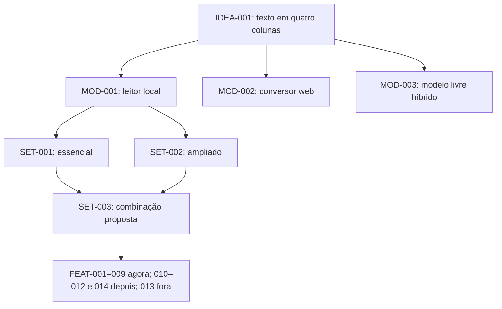

---
{
  "id": "DIAG-DET-E1_Modelos_Features",
  "etapa": 1,
  "dominio": null,
  "versao": "1.0",
  "estado": "Proposta",
  "fontes": [
    "Normativa v2.0 de 23/10/2026",
    "Solicitação do usuário de 26/10/2026"
  ],
  "ids_relacionados": [],
  "responsavel": "IA autora",
  "revisor": "Autoavaliação; independência não disponível",
  "avaliacao": "AV-E1",
  "diagrama": "DIAG-001",
  "gate": "Pendente de ratificação humana; avanço documental delegado",
  "aprovado_por": null,
  "aprovado_em": null,
  "commit_pr": null
}
---

# Comparação e escolha provisória

Fonte editável v1.0; estado Proposta; autor/conferência: mesma IA; revisão independente pendente. IDs: IDEA-001, MOD-001–003, SET-001–003, FEAT-001–014. Legenda: setas indicam consumo, composição ou transição conforme rótulo; sem componente físico implícito.

Descrição acessível: Três modelos; leitor local orienta dois conjuntos alternativos e uma combinação provisória. Simplificações: contratos/atributos completos no Markdown canônico. Semântica conferida contra fichas v1.0; renderização Mermaid não executada neste ambiente. PNG da etapa é síntese separada renderizada, e não renderização deste grafo.
