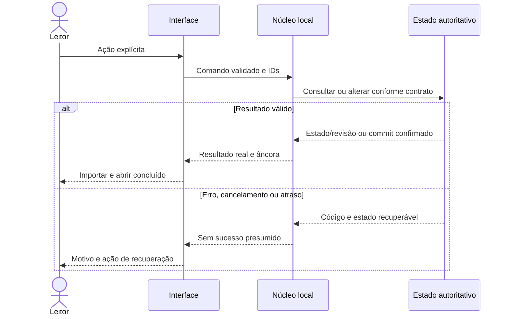
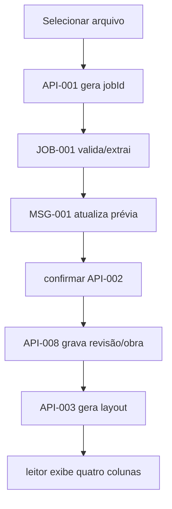

---
{
  "id": "DIAG-DET-E5_FLOW-001",
  "etapa": 5,
  "dominio": null,
  "versao": "1.0",
  "estado": "Proposta",
  "fontes": [
    "Normativa v2.0 de 23/10/2026",
    "Solicitação do usuário de 26/10/2026"
  ],
  "ids_relacionados": [],
  "responsavel": "IA autora",
  "revisor": "Autoavaliação; independência não disponível",
  "avaliacao": "AV-E5",
  "diagrama": "DIAG-005",
  "gate": "Pendente de ratificação humana; avanço documental delegado",
  "aprovado_por": null,
  "aprovado_em": null,
  "commit_pr": null
}
---

# FLOW-001 — Importar e abrir

Fonte editável v1.0; estado Proposta; autor/conferência: mesma IA; revisão independente pendente. IDs: FLOW-001, NUC-009, NUC-003, NUC-001, NUC-002, NUC-008, NUC-004, NUC-007, AC-001, AC-002, AC-003. Legenda: setas indicam consumo, composição ou transição conforme rótulo; sem componente físico implícito.

Sequência específica deste fluxo:

Descrição acessível: Selecionar arquivo → API-001 gera jobId → JOB-001 valida/extrai → MSG-001 atualiza prévia → confirmar API-002 → API-008 grava revisão/obra → API-003 gera layout → leitor exibe quatro colunas; erros: Formato inválido/protegido ou sem texto impede pronto; PDF suspeito exige aceite da ordem; sem espaço não abre obra incompleta; recuperação: Atraso mostra progresso e botão cancelar; token negado retorna à seleção; repetir commandId recupera job existente; cancelar limpa temporários. Simplificações: contratos/atributos completos no Markdown canônico. Semântica conferida contra fichas v1.0; renderização Mermaid não executada neste ambiente. PNG da etapa é síntese separada renderizada, e não renderização deste grafo.
