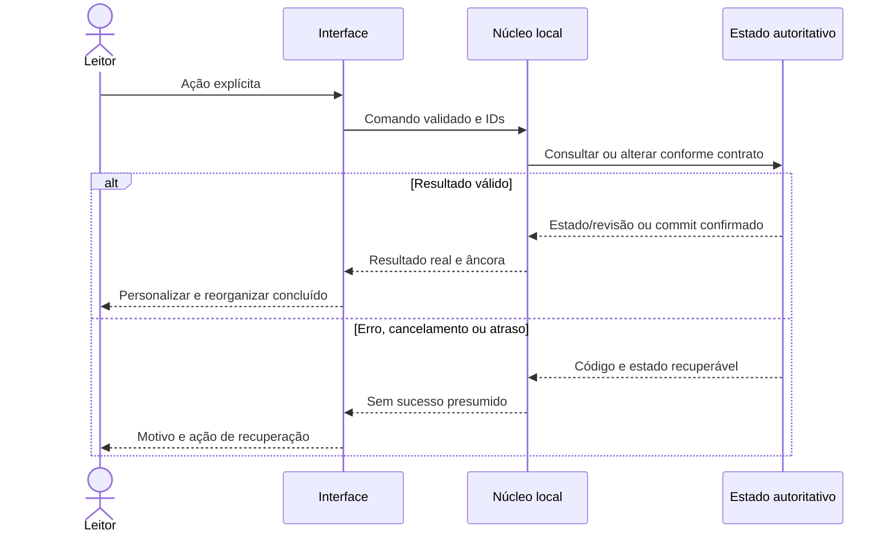
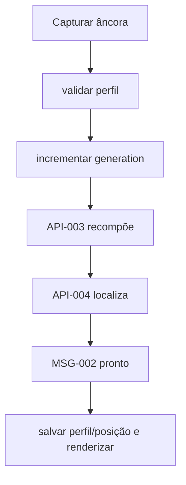

---
{
  "id": "DIAG-DET-E5_FLOW-002",
  "etapa": 5,
  "dominio": null,
  "versao": "1.0",
  "estado": "Proposta",
  "fontes": [
    "Normativa v2.0 de 23/10/2026",
    "Solicitação do usuário de 26/10/2026"
  ],
  "ids_relacionados": [],
  "responsavel": "IA autora",
  "revisor": "Autoavaliação; independência não disponível",
  "avaliacao": "AV-E5",
  "diagrama": "DIAG-005",
  "gate": "Pendente de ratificação humana; avanço documental delegado",
  "aprovado_por": null,
  "aprovado_em": null,
  "commit_pr": null
}
---

# FLOW-002 — Personalizar e reorganizar

Fonte editável v1.0; estado Proposta; autor/conferência: mesma IA; revisão independente pendente. IDs: FLOW-002, NUC-007, NUC-004, NUC-005, NUC-008, AC-003, AC-004, AC-006. Legenda: setas indicam consumo, composição ou transição conforme rótulo; sem componente físico implícito.

Sequência específica deste fluxo:

Descrição acessível: Capturar âncora → validar perfil → incrementar generation → API-003 recompõe → API-004 localiza → MSG-002 pronto → salvar perfil/posição e renderizar; erros: Fonte ausente usa fallback informado; generation obsoleta não substitui atual; falha mantém layout anterior; recuperação: Recomposição mostra ocupado; obra removida cancela e volta ao acervo; mudança rápida só aplica última geração; desfazer perfil é recuperação. Simplificações: contratos/atributos completos no Markdown canônico. Semântica conferida contra fichas v1.0; renderização Mermaid não executada neste ambiente. PNG da etapa é síntese separada renderizada, e não renderização deste grafo.
