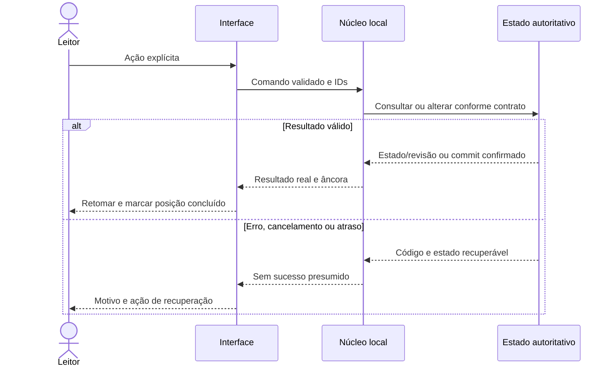
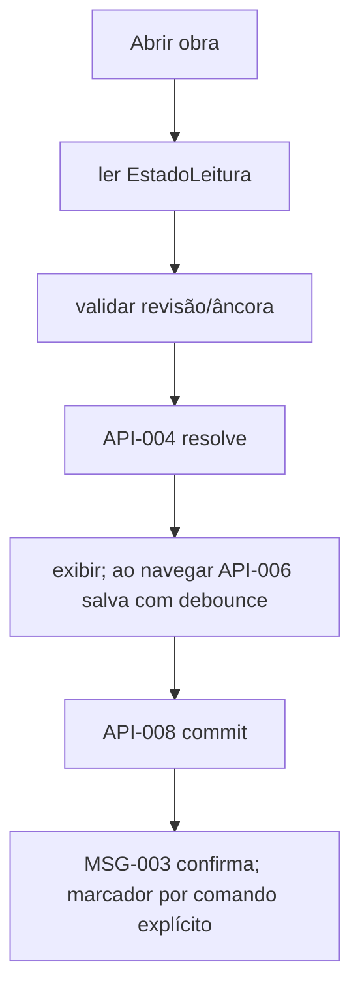

---
{
  "id": "DIAG-DET-E5_FLOW-004",
  "etapa": 5,
  "dominio": null,
  "versao": "1.0",
  "estado": "Proposta",
  "fontes": [
    "Normativa v2.0 de 23/10/2026",
    "Solicitação do usuário de 26/10/2026"
  ],
  "ids_relacionados": [],
  "responsavel": "IA autora",
  "revisor": "Autoavaliação; independência não disponível",
  "avaliacao": "AV-E5",
  "diagrama": "DIAG-005",
  "gate": "Pendente de ratificação humana; avanço documental delegado",
  "aprovado_por": null,
  "aprovado_em": null,
  "commit_pr": null
}
---

# FLOW-004 — Retomar e marcar posição

Fonte editável v1.0; estado Proposta; autor/conferência: mesma IA; revisão independente pendente. IDs: FLOW-004, NUC-009, NUC-007, NUC-005, NUC-004, NUC-008, AC-006. Legenda: setas indicam consumo, composição ou transição conforme rótulo; sem componente físico implícito.

Sequência específica deste fluxo:

Descrição acessível: Abrir obra → ler EstadoLeitura → validar revisão/âncora → API-004 resolve → exibir; ao navegar API-006 salva com debounce → API-008 commit → MSG-003 confirma; marcador por comando explícito; erros: Âncora incompatível mostra órfã e oferece início sem apagar referência; disco cheio exibe não salvo; recuperação: Escrita lenta mantém indicador pendente; obra removida encerra sessão; repetir commandId não duplica; ao fechar com pendência perguntar tentar/fechar sem salvar/cancelar. Simplificações: contratos/atributos completos no Markdown canônico. Semântica conferida contra fichas v1.0; renderização Mermaid não executada neste ambiente. PNG da etapa é síntese separada renderizada, e não renderização deste grafo.
