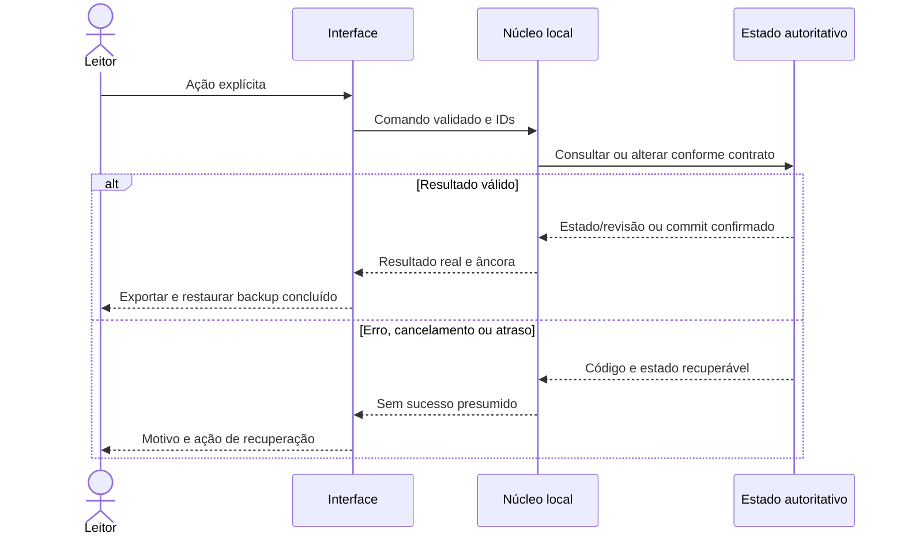
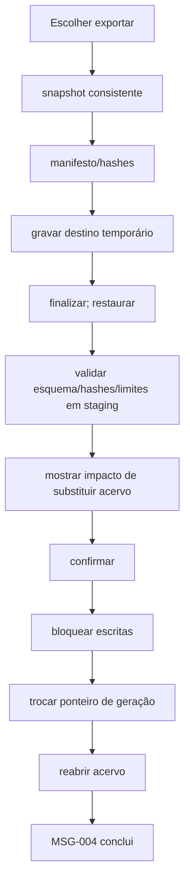

---
{
  "id": "DIAG-DET-E5_FLOW-007",
  "etapa": 5,
  "dominio": null,
  "versao": "1.0",
  "estado": "Proposta",
  "fontes": [
    "Normativa v2.0 de 23/10/2026",
    "Solicitação do usuário de 26/10/2026"
  ],
  "ids_relacionados": [],
  "responsavel": "IA autora",
  "revisor": "Autoavaliação; independência não disponível",
  "avaliacao": "AV-E5",
  "diagrama": "DIAG-005",
  "gate": "Pendente de ratificação humana; avanço documental delegado",
  "aprovado_por": null,
  "aprovado_em": null,
  "commit_pr": null
}
---

# FLOW-007 — Exportar e restaurar backup

Fonte editável v1.0; estado Proposta; autor/conferência: mesma IA; revisão independente pendente. IDs: FLOW-007, NUC-009, NUC-008, AC-009. Legenda: setas indicam consumo, composição ou transição conforme rótulo; sem componente físico implícito.

Sequência específica deste fluxo:

Descrição acessível: Escolher exportar → snapshot consistente → manifesto/hashes → gravar destino temporário → finalizar; restaurar → validar esquema/hashes/limites em staging → mostrar impacto de substituir acervo → confirmar → bloquear escritas → trocar ponteiro de geração → reabrir acervo → MSG-004 conclui; erros: Corrupção ou schema futuro aborta; backup não confiável passa pelas mesmas validações de caminho/zip; falha preserva geração anterior; exclusão de cópias externas é manual; recuperação: Sem acesso ao destino pede nova seleção; progresso e cancelamento antes da troca; após commit cancelar é N/A, oferecer restaurar snapshot anterior; repetir commandId consulta resultado. Simplificações: contratos/atributos completos no Markdown canônico. Semântica conferida contra fichas v1.0; renderização Mermaid não executada neste ambiente. PNG da etapa é síntese separada renderizada, e não renderização deste grafo.
